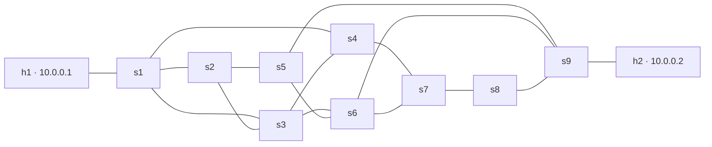

# Phase 2 — Multi-Path Mesh verification

## Pre-change architecture audit (2026-11-05)

Branch: `tushar-fixes`. `git status --short` was empty before edits.

- Dashboard startup is `POST /api/simulation/start` → controller manager → Mininet client → privileged worker's `build_network`. It does **not** execute `topo_diamond.py`; that file is an independent interactive CLI entry point. A second copy under `topology/` and controller copies under `SDN_controllers/` are not selected by backend configuration. The root controller files are the configured Ryu apps.
- Worker `build_network` hardcodes four switches, h1/s1, h2/s4 and four inter-switch links. `_clean_simulation_resources` cleans only s1–s4. Discovery, switch inspection, link changes/restoration and dataplane reset already iterate actual runtime objects.
- Mininet client has runtime/revision ownership but no topology identity. REST combines worker discovery with controller paths. WebSocket startup/status/topology snapshots similarly lack topology identity.
- All three controllers build NetworkX graphs from Ryu discovery. Baseline and Reactive use shortest paths, with no four-switch path array. Baseline intentionally performs no link-delete flow replacement. Reactive invalidates installed paths containing the failed edge and computes a replacement from the graph.
- FF creates buckets only for adjacent neighbors with strictly smaller distance to the destination. This is already graph-based and loop-free, but it does not protect every mesh edge: an available detour that first goes sideways/away from the destination is deliberately excluded. Controller reconciliation and local switch bucket selection are different operations/timings.
- Frontend graph layout is already deterministic BFS over actual nodes/links. Failure Simulator and inspector inventories already use reported links. Overview's explicit s1/s2 quick action and Failure Simulator's named Diamond presets are scenario shortcuts, not discovery; they must remain guarded by actual link presence.
- Traffic Monitor intentionally uses two project hosts, which is still correct for both requested topologies. The separate traffic configuration store must remain unchanged.
- Experiment Lab has three hardcoded Diamond failure options. The runner validates the chosen link against actual runtime discovery but does not select a topology. Records have an existing summary JSON field suitable for topology provenance without rewriting historical data.
- Analytics aggregates completed loaded records; historical records lack topology provenance. New results need explicit identity, and mixed/unknown history must not be relabeled by switch count.

## Implementation plan recorded before code changes

1. Introduce a pure topology catalog shared by worker/CLI/API. Preserve Diamond link order/port allocation. Add the exact 9-switch/14-ISL mesh and two unshaped host attachments; retain 10 Mbps/5 ms ISLs.
2. Add explicit topology selection and identity to startup, runtime REST/WebSocket snapshots and experiment summaries. Reject unknown IDs and unconfirmed/mismatched mesh startup rather than falling back.
3. Coordinate external lifecycle operations, stop old controller before replacing Mininet, and restart controller memory for a new topology. Preserve checked flow/group reset and experiment ownership/cancellation.
4. Keep controller routing policies; verify them with actual controller methods on test graphs and document FF protection limits.
5. Add a small topology selector in the existing runtime area, catalog-backed experiment link choices, runtime link inventories and topology provenance in history/analytics. Keep approved styling/motion and traffic configuration persistence.
6. Run all backend/frontend regressions, type checks/build and isolated browser checks; provide explicit live Mininet verification steps and honestly separate automated/fixture evidence from live SDN results.

## Implemented architecture

`backend/services/topology_catalog.py` is the shared, dependency-free configuration source. The privileged worker uses `populate_network`; the new `topo_multipath_mesh.py` uses the same definition for an optional standalone interactive CLI. The original `topo_diamond.py` remains available and unchanged. Do not run a standalone topology concurrently with the dashboard worker.

The approved frontend design, motion stylesheet, host addressing, traffic draft store and all three root controller scripts are unchanged. No dependencies were added.

### Exact topology

| ID | Label | Switches | Hosts | Inter-switch links | Total links |
|---|---|---:|---:|---:|---:|
| `diamond` | Diamond — Basic | 4 | 2 | 4 | 6 |
| `multipath_mesh` | Multi-Path Mesh — Advanced | 9 | 2 | 14 | 16 |

Mesh inter-switch links, exactly:

```text
s1-s2  s1-s3  s1-s4
s2-s3  s2-s5
s3-s4  s3-s6
s4-s7
s5-s6  s5-s9
s6-s7  s6-s9
s7-s8  s8-s9
```

Host attachments are h1 (`10.0.0.1/24`)—s1 and h2 (`10.0.0.2/24`)—s9. Diamond retains h1—s1 and h2—s4. All switches use OpenFlow 1.3. ISLs retain 10 Mbps / 5 ms; host links retain the previous unshaped configuration. There are no randomized conditions or routing weights.



### Lifecycle and clean switching

- Dashboard lifecycle/controller operations are serialized by `runtime_transition_lock`. They reject changes while an experiment is running; an experiment cannot begin during a manual transition. Experiment cancellation remains available and is not blocked behind its own long-running request.
- Startup captures the requested topology/controller, stops the previous controller, stops the previous Mininet network, invokes the checked controller lifecycle (clean port and flow/group reset before launch), starts fresh controller memory, and builds the requested topology against port 6653. Start/reset deliberately build fresh network state rather than reusing old controller host/port/group memory.
- A controller-only mode change on an existing network still uses the existing checked dataplane reset over **all actual switches**. Network replacement fully stops the old Mininet object, so old bridges/interfaces/flow/group state are removed before the new network is built.
- Worker fallback cleanup covers the union of catalog-owned switch names, s1–s9, rather than deleting every OVS bridge. No new `mn -c` invocation is introduced into runtime switching.
- Worker startup validates the ID before building, preserves Diamond's original link creation/port order, and cleans a partial failed construction. No fallback topology is constructed.
- Backend startup requires the worker to echo the requested ID. Missing/wrong confirmation produces a service error and attempts to stop the unconfirmed worker network; cleanup failure is itself reported as unconfirmed. An old worker must be restarted after updating this code.
- Mesh startup/stop IPC allowances are 45/30 seconds, compared with Diamond's existing 20/10 seconds; topology reads allow 15 seconds. These are bounded operation timeouts, not recovery-performance measurements.
- READY still means the existing managed controller process/listener readiness. It does not claim that every OVS switch has connected or that LLDP has converged; live checks below verify those separately.

### API and state contract

- `GET /api/topology/options`: declared topology configurations, labels, switch/host counts and candidate links. This endpoint is configuration, **not** discovered telemetry.
- `POST /api/simulation/start`: optional validated `topology_id` (`diamond` / `multipath_mesh`), alongside existing controller selection. New frontend requests send topology explicitly and send the current controller when available. Omitted IDs retain backend selection for older callers; unknown IDs are rejected with 422.
- Runtime context now includes `topology_id`, `topology_label` and `active_topology_id`. The first two identify the selected/current runtime configuration; `active_topology_id` is null unless the simulation is RUNNING. They appear in simulation status/start replies, topology REST, INITIAL_STATE and simulation/topology WebSocket state.
- Worker topology remains actual Mininet discovery: node arrays, real interfaces/ports, all links and measured UP/DOWN endpoints. Configuration definitions are never substituted for missing runtime arrays.
- A new frontend runtime clears previous nodes, paths and inspector selections. Runtime revisions still reject stale replies. Sparse updates preserve topology identity; stopped state clears live node/link/path arrays.
- `POST /api/experiments/run` accepts the topology ID. A different running topology is safely replaced before the existing experiment workflow. All comparison children retain the selected topology.
- Experiment summaries persist `topology_id` and `topology_label` in existing SQLite summary JSON. No schema migration or historical row rewrite is needed. JSON/CSV/HTML reports expose this provenance; records without it remain unknown/N/A rather than being guessed as Diamond.
- Controller event details include topology identity. Processing-time ownership and nullable metrics are unchanged.

### Frontend changes

- Small topology selector in the existing runtime area; selection survives page navigation/remount. While running, the actual runtime is authoritative and the selector is disabled. Stop before choosing a different topology. Stopped-state polling cannot overwrite an explicitly edited next-start selection.
- Graph layout still derives from actual connectivity. Networks larger than eight nodes use tighter column spacing, and a new runtime re-fits the React Flow canvas. No s1–s4 coordinates or hardcoded route arrays are used.
- Failure Simulator continues to list every actual runtime link, including the two host attachments. Its two guarded common-link shortcuts remain shortcuts, not the full inventory.
- Experiment failure options use actual runtime ISLs while RUNNING. When stopped, catalog choices are explicitly labeled configured/not running and correspond to the topology the experiment will request. Host attachments are excluded from the automated ISL selector. Invalid/missing targets cannot silently use an old Diamond link.
- History shows topology provenance. Analytics can filter mesh, Diamond, mixed history or records whose topology was not recorded. Existing completed-only aggregation, null exclusion and sample counts remain unchanged.
- Traffic Monitor's separate configuration store remains untouched, including the 500/1,000/300-packet persistence fix.

## Controller behavior and FF limitation

No controller algorithm rewrite was necessary. Tests import the actual configured root files and exercise their methods using fake datapaths/OVS messages.

**Baseline:** discovers the graph and installs existing unweighted shortest-path flows. Link-delete processing logs/rebuilds discovery but does not install an alternate route. An active-path outage is intentional.

**Reactive:** tests remove an edge on an installed mesh route, invoke the existing healing method, and verify a different graph-valid route and real next-hop-port flow actions. Paths are computed from NetworkX, not from the example route list. Equal-cost path choice can reflect discovery/insertion order; inspect the actual reported path on each live run. No optimality or weighted-quality claim is made.

**Fast Failover:** for a learned destination, the existing controller calculates destination distances. It prepares FF buckets only toward adjacent switches whose distance is strictly smaller; bucket watch ports and output actions refer to actual discovered ports. This strictly decreasing rank prevents local forwarding loops. It works with nine switches and is not tied to the Diamond shape.

However, several available end-to-end paths do **not** imply that every hop has a local FF backup. In the initial mesh graph toward s9, s1 has eligible successors s2 and s3; s2 has only s5 as a strictly closer successor. A failure of s2–s5 may require controller recomputation even though a longer detour exists. Same-distance/uphill detours are deliberately excluded, and no claim of arbitrary multi-hop local protection is made. Host access links are not made redundant by this topology.

FF group tests verify `type=ff`, real `watch_port`, matching output actions, distance-decreasing candidates and MODIFY after recomputation. Full switch timing still needs real OVS inspection. Controller recomputation duration is **not** local FF switching latency or end-to-end outage.

The current FF log contract exposes route-port summaries and recomputation events, not a verified packet-by-packet active path. The dashboard does not invent an FF active route or backup-route array when that telemetry is unavailable.

## Automated verification

| Check | Result |
|---|---|
| Backend, all existing + mesh regressions | **147 passed, 0 failed** |
| Frontend, all existing + mesh regressions | **81 passed, 0 failed** |
| Application TypeScript | PASS |
| Standalone test-source TypeScript | PASS |
| Production build | PASS; existing large JS chunk advisory remains |
| Isolated mesh browser check | PASS; 9 switches, 2 hosts, 16 edges; exact failure/restore; inspectors; experiments; switch back to Diamond |
| Traffic configuration browser regression | PASS; 500 / 1,000 / 300 and source/destination/interval preserved through telemetry and remount |
| Browser console errors in successful fixture runs | **0** |
| Whitespace check respecting existing CRLF files | PASS: `git -c core.whitespace=cr-at-eol diff --check` |

Backend tests cover exact definitions/attachments/link count/shape, unchanged Diamond port order, failed construction without fallback, nine-switch flow/group cleanup, both endpoints of s6–s9 down/up, invalid inputs, all six topology/controller startup combinations, explicit identity across REST/WebSocket, ownership/transition guards, actual controller graph methods, and mesh experiments across all three modes including cancellation/restore/provenance. Two existing mock-worker fixtures were updated to acknowledge the new topology ID; their existing assertions were retained.

Existing finite traffic tests include real local ping processes; new mesh SDN/process/OVS tests use mocks. They are not presented as live Mininet evidence. Backend output contains expected injected error messages and Ryu/Eventlet deprecation warnings; these are not failed assertions.

Frontend tests cover selector persistence, explicit controller/topology request, rejection of missing mesh confirmation, sparse identity updates/stale Diamond rejection, 11 unique layout positions, 16 actual failure controls/14 ISL experiment choices and unchanged traffic draft. Suites affected by the final explicit-controller/layout adjustment were re-bundled and rerun.

Production output: CSS 79.04 kB / 15.89 kB gzip (approved stylesheet unchanged); JavaScript 875.29 kB / 258.69 kB gzip. No package or lockfile change.

Browser runs use the real production React bundle in hidden Edge with an isolated local API/WebSocket fixture server. They never forward mutations to the user's backend or network. [Browser evidence](browser-evidence.json) records request payloads and console results. Screenshots are **fixtures, not a running SDN claim**: [mesh topology](mesh-topology-fixture.png), [mesh link DOWN](mesh-failed-link-fixture.png).

## Live verification — NOT RUN; exact manual steps

Live Mininet/Ryu/OVS mutation tests are left for the requested manual verification. No fresh live performance results are claimed. Use the existing Ubuntu-22.04 deployment and Windows Chrome through the WSL-IP HTTP address.

### One-time restart after this update

1. Stop the simulation and controller through the existing UI/API, then stop the old FastAPI process cleanly (Ctrl+C in its owning terminal). Confirm no experiment is running.
2. Identify the old privileged worker with `pgrep -af 'backend/services/mininet_worker.py'`. If still running, send `sudo kill -TERM <verified-worker-pid>` to that worker only. Its handler stops its own network and removes its socket. Do not start a second worker over the old socket.
3. From `/mnt/e/Projects/self-healing-sdn`, run `bash scripts/start.sh` (or the existing Windows launcher after the old backend is stopped). The startup script's existing `mn -c` runs **before** any controller starts. Never run `mn -c` after Ryu is running.
4. Hard-refresh Chrome to load the built assets. Check `curl -s http://127.0.0.1:8000/api/topology/options` returns both IDs and labels. A missing route or unconfirmed-topology error indicates the backend/worker is still old; do not accept a Diamond fallback.

### A. Mesh startup + Reactive

In the dashboard, select **Multi-Path Mesh — Advanced**, select **Reactive**, wait for controller readiness, then Start Simulation. Confirm RUNNING, mesh identity, 9 switches / 2 hosts / 16 total links, all 14 ISLs and the two correct host attachments. Confirm WebSocket connected.

Read-only WSL checks:

```bash
curl -s http://127.0.0.1:8000/api/simulation/status | python3 -m json.tool
curl -s http://127.0.0.1:8000/api/topology | python3 -m json.tool
sudo ovs-vsctl show
sudo ovs-vsctl --columns=target,is_connected list Controller
sudo ovs-vsctl get Bridge s9 protocols
sudo ovs-ofctl -O OpenFlow13 dump-ports-desc s9
```

There must be bridges s1–s9 with OpenFlow13 and controller targets at TCP 6653. Check actual `is_connected`, not merely the existence of a controller record. For a real Mininet pingall using the worker's owned network (not a second CLI network), run while no experiment is active:

```bash
sudo /usr/bin/python3 - <<'PY'
import json, socket
with socket.socket(socket.AF_UNIX, socket.SOCK_STREAM) as client:
    client.connect('/tmp/mininet_worker.sock')
    client.sendall((json.dumps({'command': 'pingall'}) + '\n').encode())
    print(client.makefile().readline())
PY
```

Then use Traffic Monitor for h1→h2, 500 packets at 0.05 seconds. Verify real Tx/Rx progression, replies and RTT; do not infer reachability solely from topology lines.

### B. Reactive active-path failure

While traffic is running, obtain `active_paths` from `/api/topology` and inspect actual flows if needed. Pick an inter-switch edge **on that reported path**. Do not assume s1–s2 is active. Fail the exact pair in Failure Simulator.

Verify both interfaces down using the API's `src_intf`/`dst_intf` names with `ip link show`, and inspect affected OVS port descriptions. Check the UI/API DOWN state, a new graph-valid reported path excluding that edge, resumed/continuing Rx, replacement OVS flows and actual controller event logs. Inspect `logs/controller_reactive.log`; retain old/new path evidence. Restore the exact edge and verify UP at both ends.

Controller processing is not the total packet disruption. N/A is valid if no owned recovery event was produced (for example, an inactive-link failure).

### C. Multiple alternatives in the remaining live graph

Save live topology after failure, then enumerate from its UP inter-switch links rather than the configured example paths:

```bash
curl -s http://127.0.0.1:8000/api/topology > /tmp/mesh-live-topology.json
"$HOME/sdn-env/bin/python3" - <<'PY'
import json, itertools, networkx as nx
t = json.load(open('/tmp/mesh-live-topology.json'))
assert t['active_topology_id'] == 'multipath_mesh'
g = nx.Graph()
g.add_nodes_from(t['switches'])
g.add_edges_from((l['src'], l['dst']) for l in t['links']
                 if l['status'] == 'UP' and l['src'] in g and l['dst'] in g)
paths = list(itertools.islice(nx.all_simple_paths(g, 's1', 's9'), 5))
assert len(paths) > 1, paths
print(*(' -> '.join(p) for p in paths), sep='\n')
PY
```

This demonstrates multiple valid remaining paths, not that a controller selected an optimal weighted path.

### D. Baseline

Stop simulation, retain Mesh, choose Baseline and start again. Warm up/generate traffic, inspect the actual active path, fail one of its ISLs and observe loss. There must be no proactive HEALED flow replacement by Baseline. Restore the exact edge and verify traffic recovery. Repeat Diamond + Baseline to check the original topology remains usable.

### E. Fast Failover

Stop simulation, choose Mesh + Fast Failover and start. Warm up h1↔h2 so host destinations and groups are learned. Before failure inspect:

```bash
sudo ovs-ofctl -O OpenFlow13 dump-groups s1
sudo ovs-ofctl -O OpenFlow13 dump-flows s1
sudo ovs-ofctl -O OpenFlow13 dump-ports-desc s1
```

Identify an actual `type=ff` group with at least two buckets, its primary/backup `watch_port`, and a flow referencing that group. Resolve the primary port to an actual neighbor using topology port metadata. Fail that link through the UI while traffic is running. Verify the prepared backup behavior and traffic evidence; controller reconciliation may follow.

Also inspect an intermediate one-bucket group (toward h2, s2 initially has only s5 as a strictly closer successor). A failure there may need controller recomputation. Do not describe that as protected local multi-hop FF. No local switching-time measurement has been added.

Switch from FF to Reactive/Baseline and check `dump-groups` contains no old FF group entries. Switch mesh→Diamond and verify s5–s9 bridges disappear, not merely disappear from the UI.

### F. Finite Mesh experiment

Keep mesh selected. In Experiment Lab choose Reactive, 300 packets, 0.02-second interval, failure at 2 seconds, and a valid displayed ISL. Run. Verify actual finite completion/counters/loss/RTT, no old 504 timeout behavior, a stored mesh topology label and exported provenance. Only claim healing if a valid owned event exists. Check the injected link is restored after completion and after cancelling another disposable run. Repeat supported modes as needed; compare only measured completed samples.

Finally repeat Diamond + Reactive and Diamond + FF to complete all six live combinations, then inspect Event Logs, analytics topology filtering, request-draft persistence and the browser/backend logs.

## Files changed

New runtime/configuration: `backend/services/topology_catalog.py`, `runtime_control.py`, `topo_multipath_mesh.py`.

Backend modifications: `backend/api/{controllers,experiments,simulation,topology}.py`, `backend/models/schemas.py`, `backend/services/{controller_manager,experiment_runner,mininet_client,mininet_worker,report_generator}.py`.

Frontend additions: `components/TopologySelector.tsx`, `stores/topologySelectionStore.ts`, `services/experimentLinks.ts`.

Frontend modifications: `App.tsx`, `components/TopNavbar.tsx`, `components/topology/TopologyCanvas.tsx`, `pages/{AnalyticsView,ExperimentLabView,FailureSimulatorView}.tsx`, `services/{api,topology,topologyLayout}.ts`, `stores/sdnStore.ts`, `types/index.ts`.

Tests: new `backend/tests/test_multipath_mesh.py`, `test_mesh_experiments.py`, `frontend/tests/meshFixture.ts`, `multipath-mesh.test.tsx`, `multipath-mesh.browser.mjs`; mock handshake updates in `test_runtime_errors.py` and `test_telemetry_ownership.py`; browser harness compatibility updates in `traffic-configuration.browser.mjs` and `ui-browser.mjs`. Documentation and clearly marked fixture screenshots/evidence live in this directory.

## Remaining risks and extension points

- Live WSL Mininet/OVS/Ryu switching and recovery still require the manual checks above. Browser fixtures and fake datapaths cannot prove real switch timing or actual dataplane recovery.
- Backend and privileged worker must both be restarted once to load this contract; older workers are intentionally rejected rather than silently accepted.
- The fallback cleanup allowlist is the union of project catalog switch names. Do not run a separate network using those same names concurrently on the same OVS instance.
- FF's strict distance-decreasing protection is limited as described. FF active-path telemetry and local failover timing remain unavailable where uninstrumented.
- Historical experiments without topology identity remain unknown. No records were rewritten to infer Diamond.
- BFS layout supports this mesh and disconnected graphs; very large/dense future graphs may need more sophisticated crossing minimization. No larger topology is implemented here.
- Future topology definitions can extend the catalog; runtime discovery/identity and experiment provenance are separated from future routing policy. A future adaptive strategy can be a new controller/policy, but no AI, SLA, congestion scoring, soft-failure detection or recovery-verification feature was introduced now.

The branch remains `tushar-fixes`. Changes are uncommitted and unpushed. Final `git status --short` is captured in [git-status.txt](git-status.txt).
